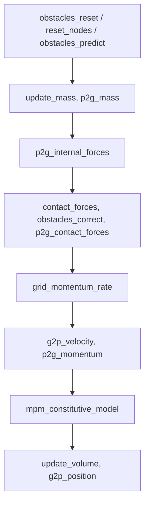

# Numerical Scheme

Two hooks of the default `simulation` block start the MPM computation:

```yaml linenums="1"
init_epilog: mpm_init            # allocates the MPM nodes, lists the cells holding MPs
compute_loop: mpm_compute_loop   # the time loop
```

`mpm_compute_loop` repeats, until `simulation_end_iteration`:

```yaml linenums="1"
mpm_compute_loop:
  loop: true
  condition: compute_loop_continue
  body:
    - mpm_begin_iteration       # outputs, log and proximity check at their periods
    - mpm_modified_lagrangian   # one MPM step
    - next_time_step            # timestep += 1, physical_time += dt
    - mpm_compute_loop_stop     # compute_loop_continue = timestep <= simulation_end_iteration
```

One step, `mpm_modified_lagrangian`, is mpmxdem's modified Lagrangian scheme split into operators:



You normally do not change it. See [Numerical Scheme](../../User/NumericalScheme/index.md) for the equations of each
operator.
