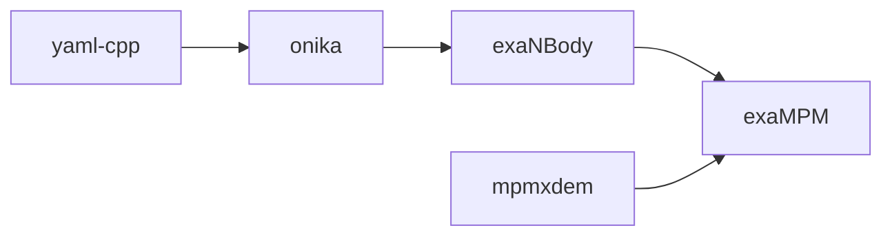

# **Installation guide**

`exaMPM` is written in `C++20` and built with `CMake` under Linux. It depends on four packages, built in this
order:

- [**CMake installation**](cmake_installation.md): requirements, then onika, exaNBody, mpmxdem and exaMPM from
  their sources.
- [**Running your simulation**](running.md): the `exaMPM` wrapper, command-line options, threads and GPU.

!!! note "No Spack package yet"

    Unlike exaStamp, exaMPM has no Spack package for now: use the CMake procedure.
