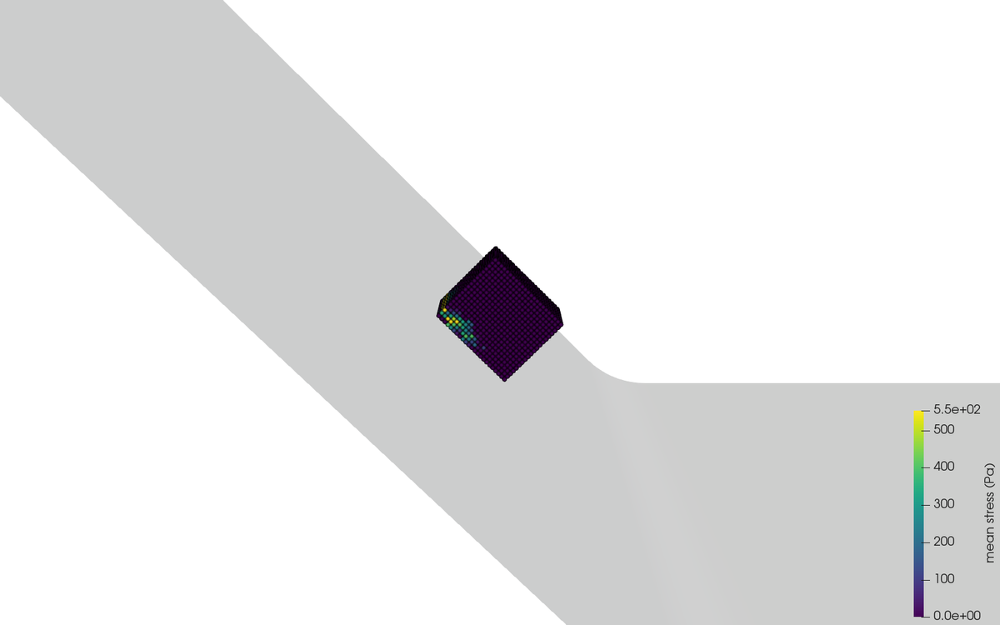

# Block sliding on a slope

<figure markdown="span">
  { width="800" }
  <figcaption>t = 0.009 s, the block on the inclined plane of the LeftBiplanar obstacle; colour: mean stress</figcaption>
</figure>

A Mohr-Coulomb block (0.2 × 0.236 × 0.2 m, 8740 material points), tilted by 45° and under a K0 initial stress,
slides down the inclined plane of a `LeftBiplanar` obstacle and spreads on its horizontal part. Port of mpmxdem's
`config#A1.sim`.

## Deck

```yaml linenums="1"
--8<-- "docs/files/config_a1.msp"
```

## Key points

- `set_mp_grid` creates the block upright, then `move_mp` rotates it by 45° around its lower corner and moves it
  onto the slope.
- `set_k0_stress` initializes the geostatic stress, with $K_0 = \nu / (1 - \nu)$.
- The grid is large (240 × 80 × 110 elements, 2.2 million nodes) for few material points: the per-node operators
  dominate the run time.

## Run

The folder `example/config_a1/` holds the deck and its picture. In the build tree:

```bash linenums="1"
cd build-exampm/example/config_a1
../exaMPM config_a1.msp --omp_num_threads 8      # full run
../exaMPM config_a1.msp --set-global-simulation_end_iteration 99 --set-global-mpm_vtk_period 50   # short run (ctest)
```

Open `mpm_paraview/mpm_*.pvtp` (material points) and `mpm_paraview/obstacles_*.vtk` (obstacles) in ParaView.

## Validation

After 2000 steps, exaMPM and mpmxdem have the same 8740 material points, and their positions differ by at most
$5.2 \times 10^{-6}$ m, the precision of mpmxdem's output files (6 digits).
