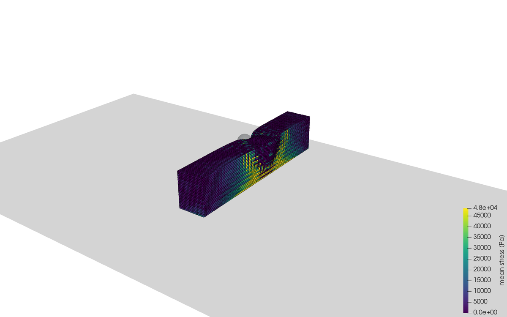
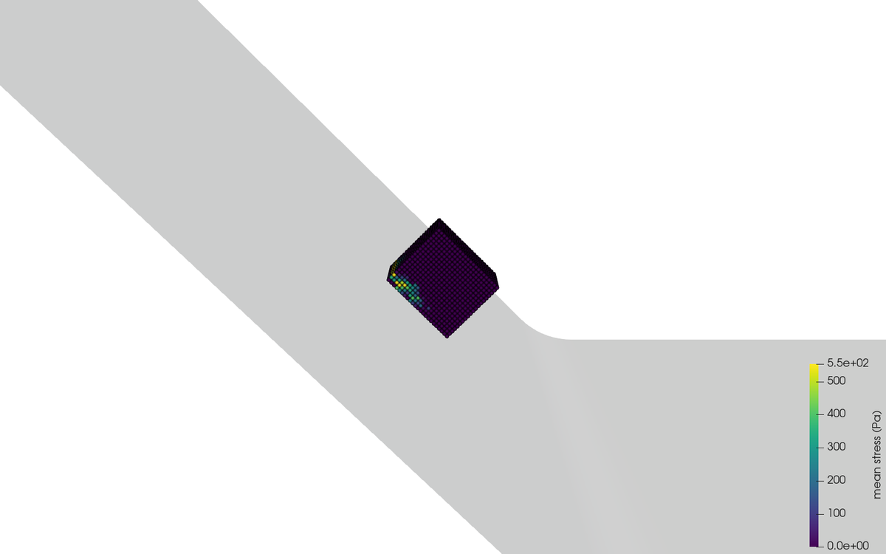
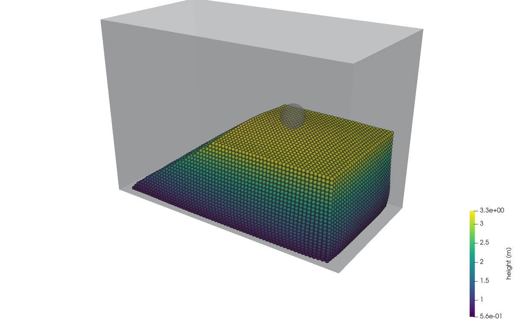
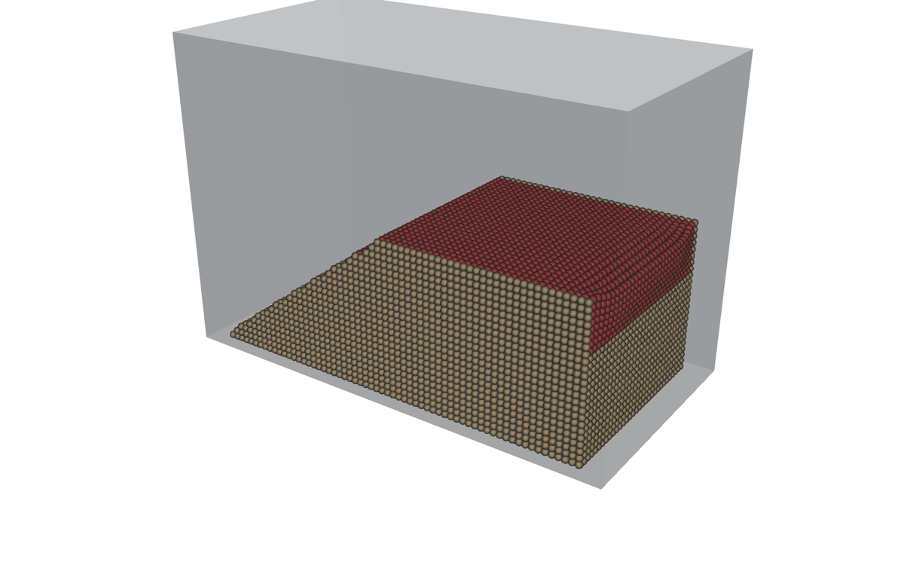
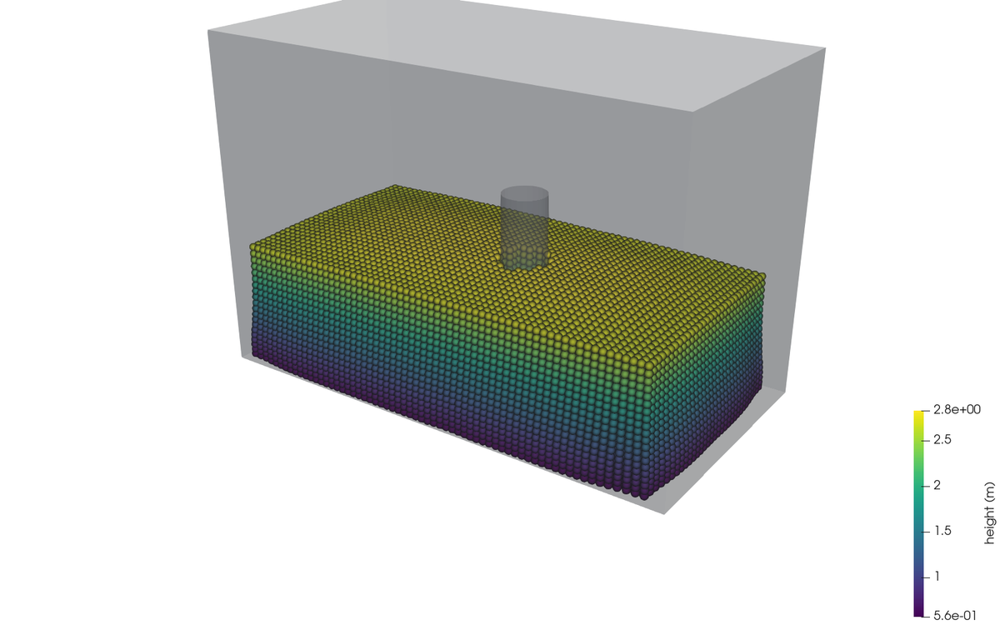

# Tutorials

The tutorials are the ports of the 3D examples of mpmxdem (`mpm/3D/Examples/*.sim`). Short versions of all of them
run in `ctest`.

## Running an example

Each example is a folder of the exaMPM repository holding its deck, the files the deck reads and a picture:

```
example/
├── empty/                        empty.msp
├── sphere_impacting_structure/   sphere_impacting_structure.msp
├── config_a1/                    config_a1.msp
├── sphere_on_slope/              sphere_on_slope.msp  coordMP.txt  coordPlanes0..4.txt  coordSpheres.txt
├── slope_two_layers/             slope_two_layers.msp coordMP.txt  modifyMP.txt  coordPlanes0..4.txt
└── piles_one/                    piles_one.msp        slope.stl    coordPlanes0..4.txt
```

The build copies every folder to `<build>/example/<name>/` (again whenever a file changes) and adds a link
`<build>/example/exaMPM` to the exaMPM wrapper, so that every example runs the same way, in its own folder:

```bash linenums="1"
cd build-exampm/example/piles_one
../exaMPM piles_one.msp                                          # full run
../exaMPM piles_one.msp --set-global-simulation_end_iteration 19 # a few steps, as ctest
```

The decks read their input files from the run directory and write their outputs there (`mpm_paraview/`,
`ExaMPMOutputDir/`), so the sources stay clean.

## Examples

<div class="center-table" markdown>

| Tutorial | mpmxdem example | Features |
| :--- | :--- | :--- |
| [Sphere impacting a structure](sphere_impacting_structure.md) | `sphereImpactingStructure.sim` | free sphere, plane, Mohr-Coulomb |
| [Block sliding on a slope](config_a1.md) | `config#A1.sim` | LeftBiplanar, `move_mp`, `set_k0_stress` |
| [Sphere on a slope](sphere_on_slope.md) | `sphereOnSlope.sim` | Blender slope, Plane2 box, Sphere2 |
| [Slope with two layers](slope_two_layers.md) | `slopeTwoLayers.sim` | `blender_modify_mp`, Hooke + Mohr-Coulomb |
| [Pile in a slope](piles_one.md) | `piles_one.sim` | STL slope, Cylinder, `obstacles_delete_inside` |

</div>

<div class="grid cards" markdown>

-   [__Sphere impacting a structure__](sphere_impacting_structure.md)

    ---

    

-   [__Block sliding on a slope__](config_a1.md)

    ---

    

-   [__Sphere on a slope__](sphere_on_slope.md)

    ---

    

-   [__Slope with two layers__](slope_two_layers.md)

    ---

    

-   [__Pile in a slope__](piles_one.md)

    ---

    

</div>

The pictures are made with ParaView, see [Example images](../User/Outputs/visualization.md#example-images).

!!! note "Not ported"

    `slopeSoftLayer.sim` is not ported: its only obstacle line is invalid (mpmxdem ignores it) and the format of its
    `coordBoundaries.txt` file is not documented.

!!! info "Running the mpmxdem originals"

    The Blender examples use the `nstep` command, which mpmxdem 3D rejects at startup: they do not run as is in
    mpmxdem. exaMPM translates `nstep 300000` into `simulation_end_iteration: 299999`.
