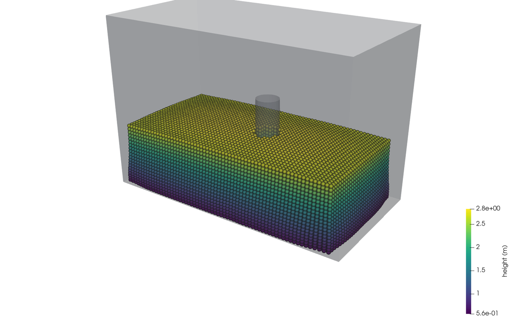

# Pile in a slope

<figure markdown="span">
  { width="800" }
  <figcaption>t = 0.27 s, with the synthetic Blender files of the repository; colour: height</figcaption>
</figure>

A fixed vertical pile (Cylinder) through a Mohr-Coulomb slope read from an STL file, in a box of 5 planes. Port of
mpmxdem's `piles_one.sim`.

## Deck

```yaml linenums="1"
--8<-- "docs/files/piles_one.msp"
```

## Key points

- `blender_set_mp_grid` with `format: stl` fills a closed mesh with material points.
- `obstacles_delete_inside` removes the material points inside the pile. As in mpmxdem, it ignores the length of the
  cylinder (see [Cylinder](../User/Obstacles/cylinder.md)).
- The material/pile contact has no friction (mpmxdem's Cylinder has no tangents), whatever `mu`.

## Input files

`slope.stl` and `coordPlanes0..4.txt`, read from the run directory. Synthetic files are provided in
`example/piles_one/` (a box-shaped slope).

## Run

The folder `example/piles_one/` holds the deck, the synthetic `slope.stl` and `coordPlanes0..4.txt`, and its picture. In the build tree:

```bash linenums="1"
cd build-exampm/example/piles_one
../exaMPM piles_one.msp --omp_num_threads 8      # full run
../exaMPM piles_one.msp --set-global-simulation_end_iteration 19 --set-global-mpm_log_period 10   # short run (ctest)
```

To run the original example, replace the synthetic files of the run folder by the Blender files of the original.

Open `mpm_paraview/mpm_*.pvtp` (material points) and `mpm_paraview/obstacles_*.vtk` (obstacles) in ParaView.

## Validation

With the files of `example/piles_one/`, exaMPM and mpmxdem create the same 40960 material points and both remove 880
of them inside the pile; positions after 2000 steps differ by less than $6 \times 10^{-6}$ m.
