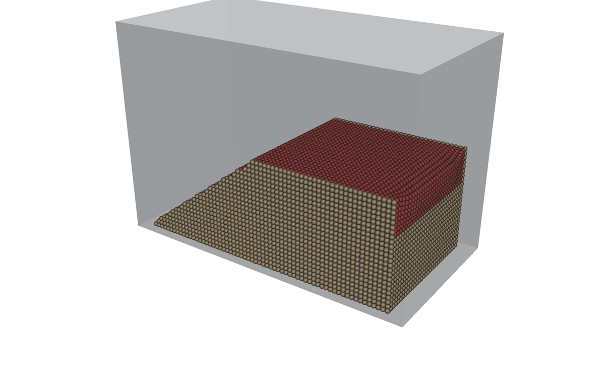

# Slope with two layers

<figure markdown="span">
  { width="800" }
  <figcaption>t = 0.27 s, with the synthetic Blender files of the repository; group 0 (elastic) in beige, weak layer (group 1) in red</figcaption>
</figure>

An elastic slope with a weaker Mohr-Coulomb layer, in a box of 5 planes. Port of mpmxdem's `slopeTwoLayers.sim`.

## Deck

```yaml linenums="1"
--8<-- "docs/files/slope_two_layers.msp"
```

## Key points

- `blender_set_mp_grid` creates the slope (group 0, Hooke elasticity), then `blender_modify_mp` moves the material
  points inside the objects of `modifyMP.txt` to group 1 (Mohr-Coulomb).
- mpmxdem changes the constitutive model of these material points but keeps their group. In exaMPM the model is
  chosen by group, so the layer is a new group, and the contact laws of group 0 are duplicated for group 1.
- The floor (`coordPlanes0.txt`) is obstacle group 0, with friction; the walls are group 1, without friction.

## Input files

`coordMP.txt`, `modifyMP.txt` and `coordPlanes0..4.txt`, read from the run directory. Synthetic files are provided in
`example/slope_two_layers/` (the layer is a 6 × 6 × 1.5 m block crossing the slope).

## Run

The folder `example/slope_two_layers/` holds the deck, the synthetic `coordMP.txt`, `modifyMP.txt` and `coordPlanes0..4.txt`, and its picture. In the build tree:

```bash linenums="1"
cd build-exampm/example/slope_two_layers
../exaMPM slope_two_layers.msp --omp_num_threads 8      # full run
../exaMPM slope_two_layers.msp --set-global-simulation_end_iteration 19 --set-global-mpm_log_period 10   # short run (ctest)
```

To run the original example, replace the synthetic files of the run folder by the Blender files of the original.

Open `mpm_paraview/mpm_*.pvtp` (material points) and `mpm_paraview/obstacles_*.vtk` (obstacles) in ParaView.

## Validation

With the files of `example/slope_two_layers/`, exaMPM and mpmxdem create the same 36864 material points (8880 of them are
moved to the layer); their positions after 2000 steps differ by less than $6 \times 10^{-6}$ m.
