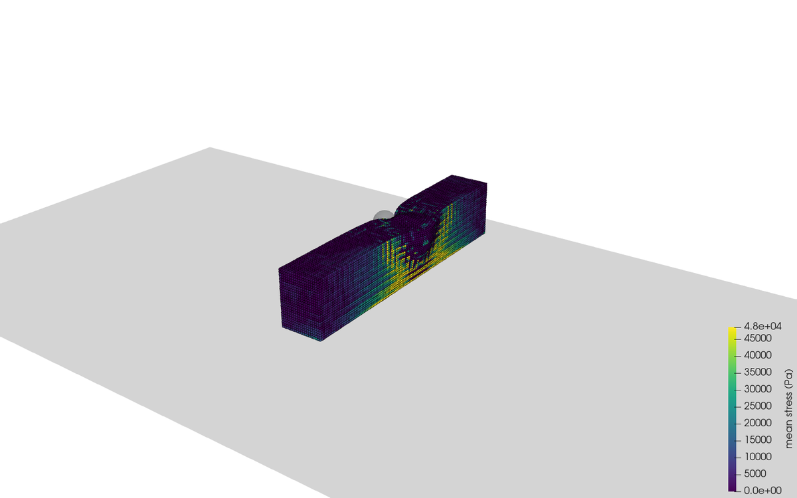

# Sphere impacting a structure

<figure markdown="span">
  { width="800" }
  <figcaption>t = 0.24 s, after the impact of the sphere; colour: mean stress</figcaption>
</figure>

A rigid sphere (R = 0.1 m, 30000 kg/m³) is thrown at 2 m/s against a cohesive Mohr-Coulomb block
(0.4 × 0.5 × 2.4 m, 57000 material points) lying on a horizontal plane. Port of mpmxdem's
`sphereImpactingStructure.sim`.

## Deck

```yaml linenums="1"
--8<-- "docs/files/sphere_impacting_structure.msp"
```

## Key points

- **Grid**: 100 × 40 × 55 elements of 0.06 m, i.e. `grid_dims: [101, 41, 56]` and a domain starting at −0.03.
- **Material points**: 3 per element and direction (`size: 0.02`).
- **Obstacles**: the sphere is group 0 and the plane group 1; the block has two contact laws, with $\mu = 0.3$ on
  the sphere and $\mu = 1$ on the floor.
- **Duration**: 50000 steps of $10^{-5}$ s, i.e. 0.5 s.

## Run

The folder `example/sphere_impacting_structure/` holds the deck and its picture. In the build tree:

```bash linenums="1"
cd build-exampm/example/sphere_impacting_structure
../exaMPM sphere_impacting_structure.msp --omp_num_threads 8      # full run
../exaMPM sphere_impacting_structure.msp --set-global-simulation_end_iteration 199 --set-global-mpm_vtk_period 100   # short run (ctest)
```

Add `--nogpu false` to run the kernels on the GPU.

Open `mpm_paraview/mpm_*.pvtp` (material points) and `mpm_paraview/obstacles_*.vtk` (obstacles) in ParaView.

Add `mpm_log_extra: print_obstacles` to the deck (or `--set-mpm_log_extra print_obstacles`) to follow the sphere.
The sphere hits the block after about 0.15 s.

!!! tip "Comparing with mpmxdem"

    mpmxdem's plane vectors are not normalized (see [Plane](../User/Obstacles/plane.md)). Use
    `obstacles: { legacy_plane: true }` to compare with mpmxdem's results, and compare before the impact or with a
    tolerance: the atomic sums make multi-threaded runs not bitwise reproducible.
