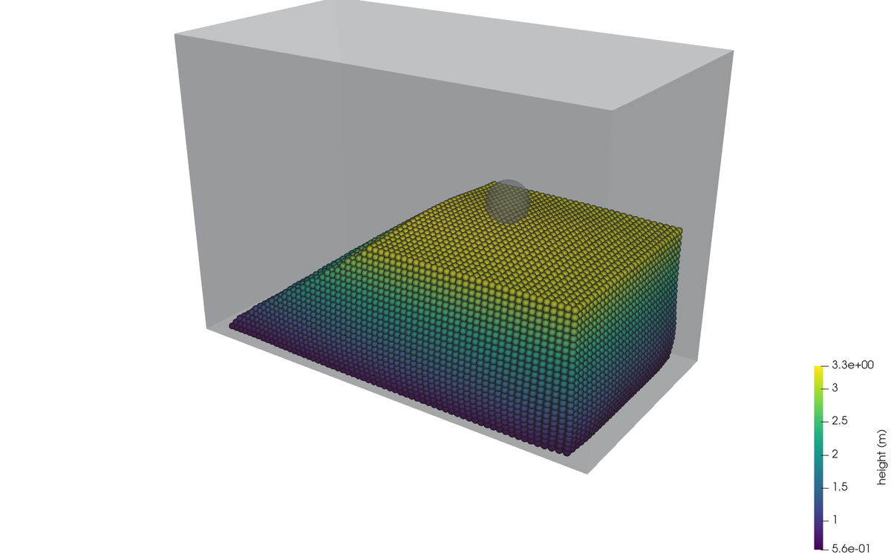

# Sphere on a slope

<figure markdown="span">
  { width="800" }
  <figcaption>t = 0.27 s, with the synthetic Blender files of the repository; colour: height</figcaption>
</figure>

A free sphere falls on a Mohr-Coulomb slope standing in a box of 5 planes. The slope, the planes and the sphere are
read from Blender files. Port of mpmxdem's `sphereOnSlope.sim`.

## Deck

```yaml linenums="1"
--8<-- "docs/files/sphere_on_slope.msp"
```

## Input files

The deck reads `coordMP.txt` (slope, see [coordinate files](../User/MaterialPoints/blender_files.md)),
`coordPlanes0..4.txt` (box) and `coordSpheres.txt` (sphere) from the run directory.

The Blender files of the original example are not distributed with mpmxdem. The exaMPM repository provides small
hand-written files in `example/sphere_on_slope/` (a 8 × 4 × 3 m slope, a box and a sphere of radius 0.4 m), used by the
test.

## Run

The folder `example/sphere_on_slope/` holds the deck, the synthetic `coordMP.txt`, `coordPlanes0..4.txt` and `coordSpheres.txt`, and its picture. In the build tree:

```bash linenums="1"
cd build-exampm/example/sphere_on_slope
../exaMPM sphere_on_slope.msp --omp_num_threads 8      # full run
../exaMPM sphere_on_slope.msp --set-global-simulation_end_iteration 19 --set-global-mpm_log_period 10   # short run (ctest)
```

To run the original example, replace the synthetic files of the run folder by the Blender files of the original.

Open `mpm_paraview/mpm_*.pvtp` (material points) and `mpm_paraview/obstacles_*.vtk` (obstacles) in ParaView.

## Validation

With the files of `example/sphere_on_slope/` and `legacy_plane: true`, exaMPM and mpmxdem create the same 36864 material
points; after 2000 steps their positions differ by less than $6 \times 10^{-6}$ m and the sphere trajectories by
about $10^{-6}$ m.
