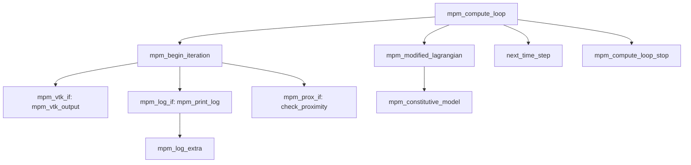

# Simulation Graph

The default configuration `data/config/main-config.msp` defines the `simulation` block, a fixed sequence of
**hooks**, and the **MPM building blocks** that MPM decks plug into these hooks.

## Hooks

| Hook | Default | Typical MPM deck |
| :--- | :--- | :--- |
| `hw_device_init` | `mpi_comm_world`, `init_cuda` | — |
| `init_prolog` | `global` | — |
| `input_data` | `nop` | `parameters`, `domain`, `grid_flavor_mpm`, `init_rcb_grid`, MP setters, `obstacles`, `contact_laws` |
| `init_epilog` | `nop` | `mpm_init` |
| `first_iteration` | `nop` | — |
| `compute_loop` | `nop` | `mpm_compute_loop` |
| `simulation_epilog` | `nop` | — |
| `hw_device_finalize` | `finalize_cuda` | — |

Extend the application by overriding these hooks (in a deck), never by editing `simulation`.

## MPM blocks

| Block | Content | Override to... |
| :--- | :--- | :--- |
| `mpm_init` | `init_nodes`, `update_mp_cells` | — |
| `mpm_compute_loop` | the time loop, until `simulation_end_iteration` | — |
| `mpm_begin_iteration` | triggers and runs the periodic outputs, log and proximity check | — |
| `mpm_modified_lagrangian` | one MPM time step ([details](../NumericalScheme/index.md)) | change the scheme |
| `mpm_constitutive_model` | `nop` | **required**: the constitutive model(s) |
| `mpm_vtk_output` | `mpm_write_paraview` | add `save_mp_pos`, change the output |
| `mpm_write_paraview` | ParaView files of the MPs and obstacles | change the fields written |
| `mpm_print_log` | `simulation_state`, `print_simulation_state`, `mpm_log_extra` | — |
| `mpm_log_extra` | `nop` | e.g. `print_obstacles` |

The periods are the global values `mpm_vtk_period`, `mpm_log_period` and `mpm_prox_period`; each output also runs at
the first step. The full file is shown in [Default YAML](default_yaml.md).
